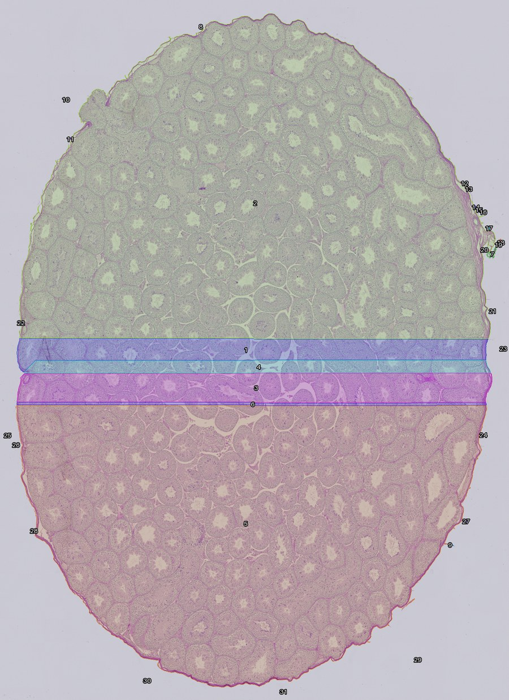
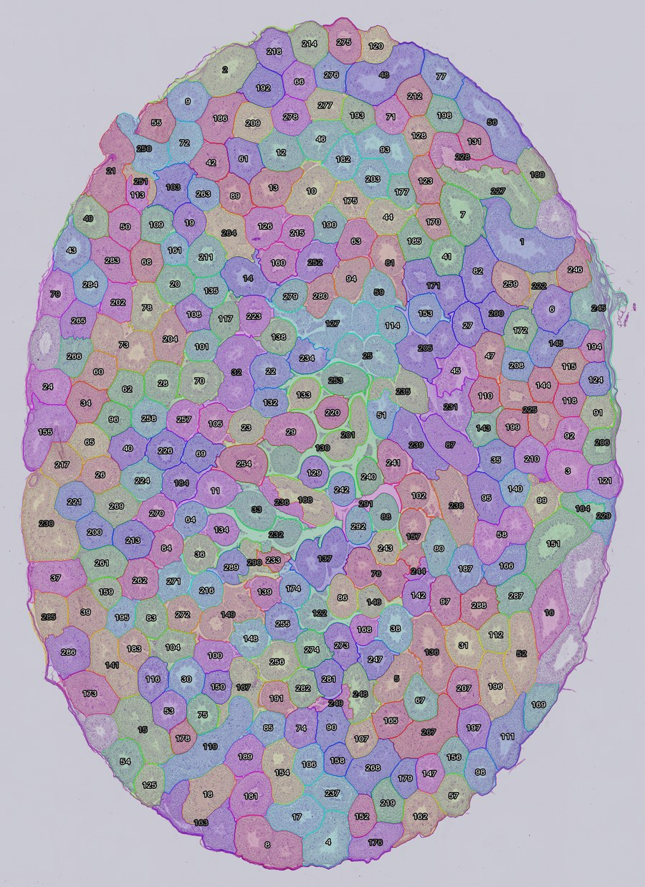

# EyeSpySpermatogenesis

Welcome to the reboot of EyeSpySpermatogenesis. For context, about a year ago I started this project with the intent of doing it entirely with image recognition via a CNN, if I remember correctly. The issue with this of course, was that not only was it inefficient, but required me to clearly annotate hundreds if not thousands of tubule images, manually drawing polygons around each tubule to train the AI to recognize individual tubules.

We didnt even get to categorization, mainly because of how long training and annotation took. So this project went back on the shelf, and was abandoned. However, now after EyeSpySC and SCP, Ive realized that all along I did not actually need machine learning to find individual tubules. Similairly to the aforementioned repos, here we do simple (ish) image processing to deterministically sift through these images to crop out each individual tubules. Eventually, once thats fully done we will move on to analyzing them and actually training a stage identifier.

Technical details below~

## Technical details

### Scope and current status

EyeSpySpermatogenesis targets **mouse, PAS-stained, FFPE testis histology at native
40×-equivalent detail**. Planned inputs are a complete tissue section in a large
OME-TIFF, or a folder of existing 40× images containing one or multiple tubules.

**An overview-first prototype finds individual tubules in whole-section images.**
It builds a reduced overview without decoding a full native image array, outlines
candidate tubules along their PAS-stained basement membranes, and exports
original-pixel crops centred on each tubule, with provenance. The current method
(v0.3) is described below, and its accuracy is measured by manual click-review,
not claimed. Native boundary refinement, staging and a GUI are not implemented.
See [validation](docs/VALIDATION.md) and the [prototype guide](docs/OVERVIEW_PROTOTYPE.md).

### Current comparison: v0.3 against the first attempt

The same whole section, processed by the first attempt (v0.1, left) and the
current method (v0.3, right). Each coloured, numbered region is one candidate.

| First attempt (v0.1): 31 regions | Current method (v0.3): 292 regions |
|---|---|
|  |  |

v0.1 thresholded tissue darkness. Tubules are packed edge to edge, so the whole
section became a few giant regions. v0.3 instead traces the boundary network:
each tubule is wrapped in a thin magenta PAS-positive membrane, and the regions
enclosed by that network become candidates. It then
- folds lumen cores and splinters back into their tubule,
- splits regions holding two separated lumens (adjacent tubules sharing a faint wall),
- rejects capsule strips, and
- flags doubtful candidates.

Manual review of one crop per candidate (does the outline trace one tubule?):

| Version | Sections reviewed | Crops reviewed | Unflagged crops showing one tubule |
|---|---|---|---|
| v0.2 | 3 (used afterwards to tune v0.3) | 506 | 87% |
| v0.3 | 3 (not used for tuning) | 493 | **93%** (336 of 360) |

The legacy approach (branch `legacy`) trained a small U-Net on hand-drawn tubule
polygons. It needed extensive annotation and never reached a completed
quantitative benchmark; see [legacy findings](docs/LEGACY_FINDINGS.md).

Known limits and next steps:
- Two tubules sharing a very faint wall can still merge.
- Outlines can leak into interstitial space ("spikes").
- Flags are now too cautious.
- v0.4 will trim outlines and re-check large regions at higher resolution.

PAS counterstain, physical pixel spacing, acquisition equipment and pyramid
structure remain unconfirmed. **40× does not establish µm/pixel**, and enlarging
a lower-resolution image cannot restore native detail.
See [the experimental specifications](docs/EXPERIMENTAL_SPECIFICATIONS.md).

### Planned processing

The owner selected **overview-first processing (D2)** on 2026-11-06:

1. **Make a whole-section overview:** use an independently checked stored pyramid
   level, or area-average the original TIFF one storage segment at a time.
2. **Locate provisional tubules:** a watershed over the PAS membrane network on
   the overview gives candidates in whole-section coordinates. Review misses,
   merges and splits.
3. **Retrieve native crops:** read each candidate's bounding box plus margin from
   the original source. Export original pixels and a projected overview seed mask.
4. **Later boundary refinement and analysis:** trace and validate native boundaries
   on representative PAS images before final measurements or staging.

No fixed discovery grid is required. Overlapping native windows remain a fallback
comparison. Existing folder frames use their own source coordinates; their true
image-border truncation cannot be recovered. The prototype currently takes one
TIFF per invocation; folder batch extraction remains later work.

Start with overview-only and manual crop checks. Automatic candidates require
`--detect`; every candidate is labeled for review. The [prototype guide](docs/OVERVIEW_PROTOTYPE.md)
explains commands, defaults, supported layouts, outputs and real-image validation.

### Software and setup

Python 3.11+. The base package has no mandatory runtime dependencies. The optional
Phase 1 `io` extra pins **tifffile 2025.6.11** and **NumPy 2.2.6** as a small trial
environment; it does not select our final whole-slide reader. Development uses
pytest and Ruff. The optional `prototype` extra adds **SciPy 1.15.3** and
**scikit-image 0.25.2** for the experimental classical comparator. No neural network
or GUI stack is needed.

```bash
python3 -m venv .venv
source .venv/bin/activate
python -m pip install -e '.[dev,io]'
```

On Windows, create the environment with `py -3 -m venv .venv` and activate it
with `.venv\Scripts\Activate.ps1`, then use the same `python -m ...` commands.
Installation needs package access; metadata inspection runs locally afterward.

### Inspecting example TIFFs

Put examples in `data/pilot/` (Git-ignored), or use another local folder. Keep
original acquisition files and companion OME-TIFF files together. No annotations
are needed for this first inspection.

```bash
python -m eyespy_spermatogenesis.io.inspect_tiff data/pilot \
  --output outputs/phase1/inspection.json
```

The report records dimensions, axes/channels, bit depth, compression, tiles or
strips, pyramid levels, reported calibration and optional checksums. It never
automatically chooses a series or certifies 40× detail. Reported calibration
remains pending verification.

Currently only TIFF inputs are inspected; folder scans list skipped non-TIFF
files. Use `--recursive` for subfolders and `--sha256` to stream-hash entire files
(additional disk I/O). Existing reports are never overwritten; use a new output
filename when rerunning. Metadata inspection alone does not prove memory-bounded
cropping or image compatibility. The [Phase 1 guide](docs/PHASE1_IO_VALIDATION.md)
describes the report, pilot manifest and upcoming crop checks.

### Running the overview-first prototype

```bash
python -m pip install -e '.[dev,io,prototype]'
python -m eyespy_spermatogenesis.overview_pipeline /path/to/section.ome.tif \
  --series 0 --downsample 8 --output outputs/overview-io-01
```

Select the tissue series from inspection; `0` is only an example. Add
`--roi X0 Y0 X1 Y1` for a manual native-pixel crop, or `--detect` for provisional
candidate crops and seed masks. Always use a new output directory. The overview
factor and morphology defaults are untuned; no µm/pixel is inferred. See the
[prototype guide](docs/OVERVIEW_PROTOTYPE.md) before using stored pyramid levels.
The supplied JPEG TIFFs additionally use the optional `jpeg` extra
(`imagecodecs==2025.3.30`), already installed in the local `.venv`. Use
`--detect --skip-crops` for numbered PNG overlays and counts without native crop
exports. PNG review uses Pillow, included in the prototype extra.

### Development checks

```bash
python -m ruff check .
python -m ruff format --check .
python -m pytest
```

Synthetic tests check metadata, bounded region access, streamed overviews,
coordinates, candidate handling, original-pixel crops, source preservation and
errors. They do not validate lab images or biological performance. CI is configured
to install development, I/O and prototype extras on Python 3.11–3.13.

### Roadmap and documentation

Phase 0 established the clean repository. Phase 1 validates images and region
access; Phase 2 compares isolation prototypes; Phase 3 establishes reliable
extraction; Phase 4 evaluates staging; Phase 5 integrates batch workflows and
eventual application packaging.

- [Overview-first prototype](docs/OVERVIEW_PROTOTYPE.md)
- [Project plan](docs/PROJECT_PLAN.md) and [architecture](docs/ARCHITECTURE.md)
- [Software evaluation](docs/SOFTWARE_EVALUATION.md) and [prototypes](docs/PROTOTYPES.md)
- [Evaluation plan](docs/EVALUATION_PLAN.md) and [staging strategy](docs/STAGING_STRATEGY.md)
- [Legacy findings](docs/LEGACY_FINDINGS.md) and [decision log](docs/DECISIONS.md)

The original code/history remain on `legacy`; `main` contains the reboot.
Related repositories: [SCP-SpermColorPixels](https://github.com/Bioticcc/SCP-SpermColorPixels)
and [EyeSpySC](https://github.com/Bioticcc/EyeSpySC). Their acquisition-specific
thresholds are not assumed to transfer to PAS histology. Project licensing and
target hardware/OS requirements remain pending owner selection.
