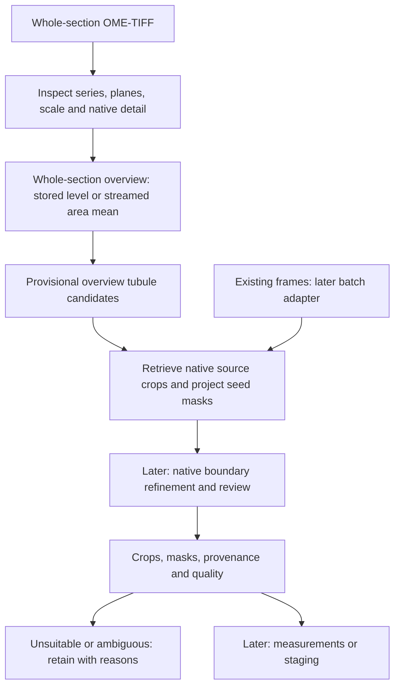

# Proposed architecture

**Prototype implementation, 2026-11-06.** Metadata inspection, restricted
single-plane TIFF region reads, streamed overviews, provisional overview
candidates and original-pixel crop/seed export are implemented. Only synthetic
mechanics have been tested; real-image I/O and biology remain unvalidated.
Native boundary refinement remains unimplemented. Staging exists as an
experimental research pipeline on accepted crops (EyeSpy, decision 027;
`staging/eyespy.py`), evaluated leave-one-section-out against unchecked
labels; the `StageResult` contract below is still a proposal. See
[OVERVIEW_PROTOTYPE.md](OVERVIEW_PROTOTYPE.md). The full contracts below remain
proposals; the prototype manifest is a separate versioned trial format.

The owner selected overview-first D2 on 2026-11-06, superseding grid-first D1.
D1 overlapping reads remain a fallback comparison, D3 QuPath an integration
comparator. Overview localization may miss or merge objects; global coordinates
avoid grid reconciliation but do not establish correct instances. Folder batch
adaptation remains future work; each frame is an independent source.

## Module boundaries

| Module | Responsibility |
|---|---|
| `io` | File discovery, metadata reports, reader selection, bounded region retrieval |
| `segmentation` | Candidate generation/separation, reconciliation and crop export |
| `staging` | Eligibility, classifier/features, taxonomy, uncertainty and abstention |

Downstream modules use the shared contract. They must not branch on whether the
source was an OME-TIFF or folder. Reader and application-specific conversions
belong in adapters, with explicit records of any irreversible changes. Shared
data contracts, external-tool adapters and grouped evaluation get their own
subpackages when real code needs them (the empty placeholders were removed on
2026-11-13).

## Shared analysis input: proposed `AnalysisRegion`

| Field group | Required meaning |
|---|---|
| Identity | `schema_version`, `region_id`, immutable `source_id`, checksum/algorithm, original locator and acquisition ID if known |
| Pixels | Lazy reader handle/reference, selected series and Z/C/T planes, pyramid level, requested bounds; bounded arrays allowed for folder images |
| Axes | Dimensions, dtype/bit depth, channel count/order, color space, photometric interpretation and ICC identity; no silent channel dropping |
| Source geometry | Full-resolution width/height; source bounding box; `region_to_source` transform; coordinate convention and rounding policy |
| Scale | Independent X/Y µm/pixel values or `null`; units; source metadata field or calibration record; verified/conflicting/missing status |
| Acquisition | Reported magnification, its convention and provenance; native-detail eligibility and reason; never infer µm/pixel from 40× |
| Biology | Mouse, PAS, FFPE; counterstain and all other pending biological fields nullable with evidence source |
| History | Ordered preprocessing/resampling/color operations, software/config hashes, interpolation, input/output geometry and derived-image identity |
| Context | Animal/section/batch IDs if supplied; tissue/coverage references and border flags; unknown IDs remain unknown |

Metadata normalization changes representation, not image meaning. Preserve native
unannotated pixels, original bit depth and channels. Record separate display or
algorithm arrays for color conversion, rescaling, stain separation or filtering.
Do not apply H&E stain vectors to PAS without validation. Conflicting physical
spacing remains unresolved until checked; physical measurements stay null.

## Coordinate contract

- Use decoded full-resolution **source pixel-edge coordinates**, origin at the
  upper-left, X right and Y down. Boxes are half-open `[x0, y0, x1, y1)`.
  Pixel `(i,j)` has center `(i+0.5,j+0.5)`. Persist the raw TIFF orientation
  separately; any decoder rotation/flip must have an explicit transform.
- Identify series and plane in every source reference. A folder image is its own
  source with origin `(0,0)`; never invent its location on a whole slide.
- For aligned pyramids, map a level ROI to source by independent verified X/Y
  scale and offsets. `x_source = offset_x + scale_x * x_region`, likewise Y;
  derive effective ratios from actual geometry, not an assumed 2× pyramid.
  Store an affine transform where orientation/cropping requires it.
- Round retrieval bounds outward (floor minima, ceil maxima), clip to source
  extent and record padding. Keep floating geometry distinct from integer crop
  bounds. Verify mappings on landmarks and level-edge cases before use.
- Physical coordinates use verified spacing and a declared local origin. They
  are not a scanner stage-coordinate claim. Anisotropic pixels require X/Y-aware
  area and shape measurements; do not silently apply isotropic formulas.

## Input A: large OME-TIFF

Inspect headers and OME-XML before allocating pixels. Resolve multifile companions,
series, associated images and planes explicitly. Reader trials must establish
bounded decoding; a lazy-looking API is not proof of low memory use. Bound tile
caches, worker count, queue size and output buffers as well as tile dimensions.

D2 is the initial path: use a checked lower-resolution level or derive an
overview by streamed area averaging. Localize provisional candidates globally,
retrieve their native bounding regions plus context, and preserve source-space
transforms. Native refinement is a later real-image-informed step; projected
seed masks must never be presented as verified native contours.

The prototype requires explicit pyramid selection and an operator alignment
assertion; it does not silently treat dimension ratios as alignment proof. There
need not be a nominal 20× level. If no useful stored level exists, derive a bounded
overview from native segments. Lack of a pyramid and lack of native optical
detail are separate issues. Unverified detail permits characterization and
provisional extraction only; it does not establish staging eligibility.

## Boundaries, duplicates and reconciliation

D1 fallback requirements below remain proposed, not implemented. D2 still needs
merge/split/miss checks against expert whole-section references.

Transform candidates to source coordinates before deduplication. Use overlapping
masks/contours, containment, centroid proximity and quality evidence; box overlap
alone may merge adjacent real tubules. Keep candidate-to-final-instance lineage.
If a candidate touches an internal tile edge, retrieve expanded native context
and reconcile/resegment with the same method. If still unresolved, retain the
ambiguous cluster; do not stitch incompatible partial masks into a claimed tubule.
Distinguish internal tile borders, true image/tissue borders and processing gaps.
Preserve seam diagnostics and coverage maps. No overlap size can be chosen until
observed tubule sizes and target resources are known.

## Shared outputs: proposed `TubuleInstance` and `StageResult`

Each candidate has a stable instance ID, source/region lineage, source-space mask
or contour, native bounding box and crop-to-source transform. Export an
unannotated original crop plus aligned binary mask; a masked crop is optional
and explicitly derived. Lossless TIFF is a candidate format, not a settled reader
dependency. Include measured scale, units, geometry, quality flags, method/version,
config digest, run ID and preprocessing history in versioned JSON/CSV manifests.
Use pixels/pixels² when uncalibrated; never label them µm/µm².

Proposed primary review categories: accepted transverse; oblique/longitudinal;
partial/border-truncated; touching/ambiguous; artifact/rejected. Retain multiple
reason flags because conditions overlap. Biological review must refine these;
irregular shape or absent lumen alone is not proof of artifact or pathology.

Keep isolation measurements/confidence separate from staging eligibility,
probabilities, calibrated confidence, model identity, taxonomy version and
abstention reason. Raw scores need not be probabilities. Stage fields are null
for ineligible/unrun cases; they are never encoded as stage zero.

## Reproducibility and integration

Future runs store checksummed source manifests, explicit file ordering, config,
tool versions, models/checksums, random seeds where applicable, logs, cache/resource
limits and output checksums. External jobs use argument arrays, explicit working
directories, exit-code/log capture and cancellation. A successful exit is followed
by output shape/coordinate checks. Training annotations and tool projects are
versioned artifacts outside Git until approved; none are bundled automatically.
